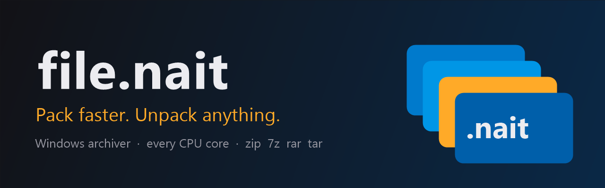
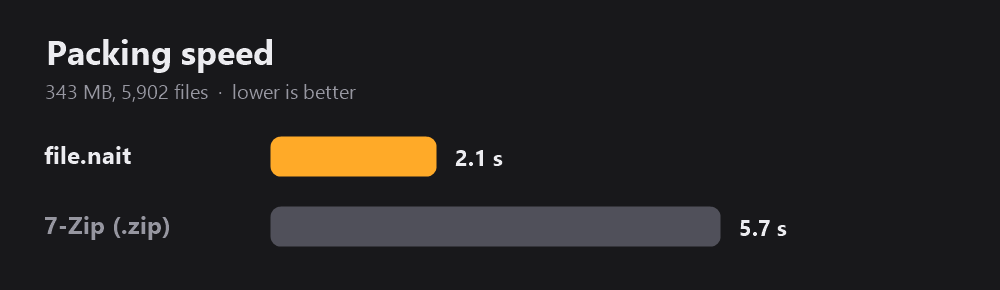
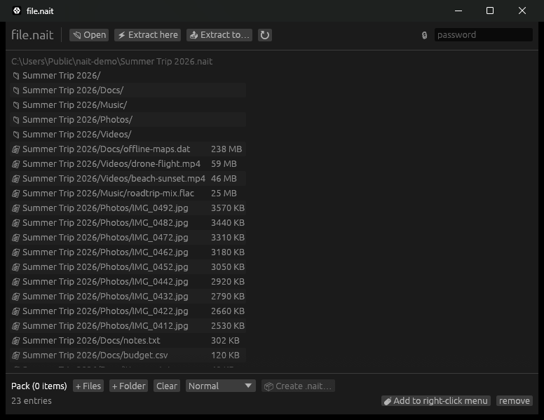
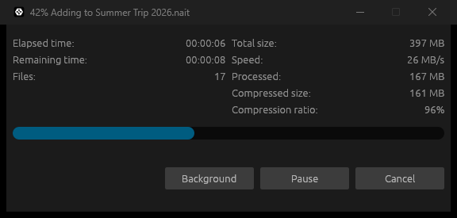
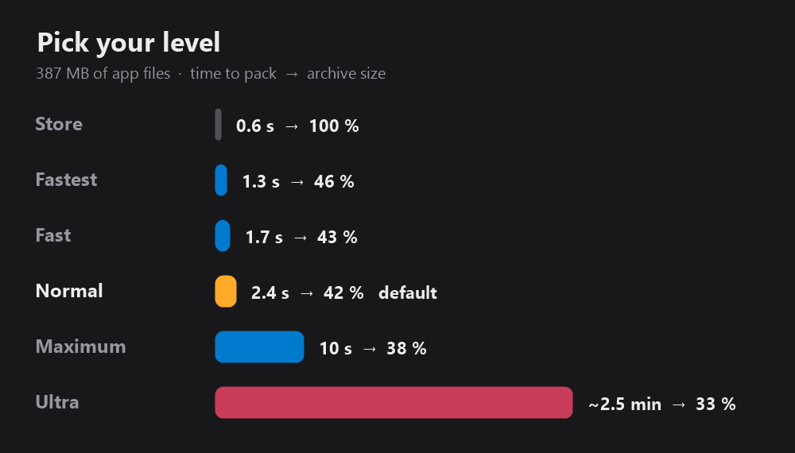
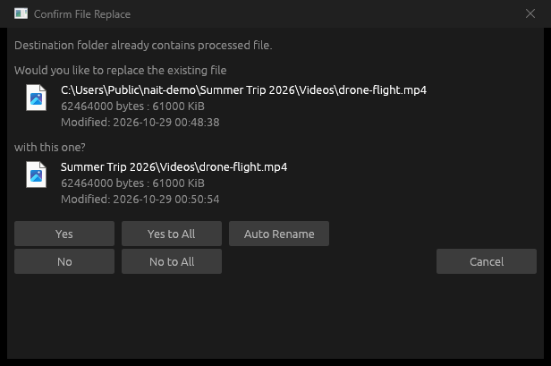

  

  
  
  
  

<h3 align="center">
  🗜️ The archiver that uses <i>all</i> of your PC, not just one core. 
  <a href="https://github.com/aywalh/file.nait/releases/latest/download/nait-win64.exe">⬇️ Download nait-win64.exe</a>  ·  <a href="https://file-nait.vercel.app">🌐 Website</a>
</h3>

---

## ⚡ Why file.nait?

7-Zip and WinRAR were built when PCs had one or two cores. **file.nait packs on every core at once**, and it doesn't waste time re-squeezing photos and videos that can't get any smaller.

**2.7× faster** than 7-Zip on the same folder. Same files, same PC, less waiting.

## 🖥️ Looks like this

Open any archive, look inside, then click **Extract here** or **Extract to…**. Drop files in, pick a level, and click **Create .nait**. That's the whole app.

## 📊 Live progress, 7-Zip style

You see the time left, the speed, the files, the sizes and the ratio in real time. **Pause** it, **Cancel** it, or send it to the **Background** so your PC stays snappy while it works.

## 🎚️ You choose: speed or size

**Normal** is the sweet spot and the default. Need it tiny? **Ultra** squeezes out every byte, it just takes its time. The right-click menu uses your choice too.

## 🔁 No more "this file already exists" chaos

You see both files with their real icons, sizes and dates, then pick **Yes**, **No**, **Auto Rename** or **… to All**.

## 🧰 Everything it does

| | |
|---|---|
| 📦 **Packs** | into `.nait`: zstd on every CPU core, with media stored as-is |
| 📂 **Opens** | `.nait` `.zip` `.7z` `.rar` `.tar` `.tar.gz` `.tgz`, password zip/7z included |
| 🖱️ **Right-click menu** | Extract here · Extract to folder · Add to *name*.nait |
| 💣 **Zip bomb shield** | refuses archives that would blow up to over 1000× their size, and checks free disk space first |
| 🛡️ **Safe paths** | no archive can write outside the folder you picked |
| 🗂️ **Real icons** | `.nait` files get the zipped-folder icon in Explorer |
| 🔄 **Self-updating** | a new release shows an **Update** button, and one click installs it |
| 🪶 **One file** | a single ~9 MB exe: no installer, no runtime, no bloat |

## 🚀 Install in 10 seconds

1. **[Download nait-win64.exe](https://github.com/aywalh/file.nait/releases/latest/download/nait-win64.exe)**
2. Open it. That's it, it's the whole app.
3. Optional: click **Add to right-click menu**. Windows asks for admin once.

> **Windows says "unknown publisher"?** file.nait isn't code-signed (yet). Click **More info → Run anyway**.

**Updating:** click **⬆ Update** in the app, or just open a newer `nait-win64.exe`. It replaces the old one, right-click menu included.

## 🔒 Privacy

file.nait runs **100 % offline**. The only network request it ever makes is the update check: *"GitHub, what's the newest release?"*

There are no accounts, no telemetry and no tracking, and nothing about your files ever leaves your PC.

## ⚖️ License

Free to use, forever. **Not open source**, all rights reserved. Please don't redistribute modified copies.

made with too much ☕ · <a href="https://file-nait.vercel.app">file-nait.vercel.app</a>

